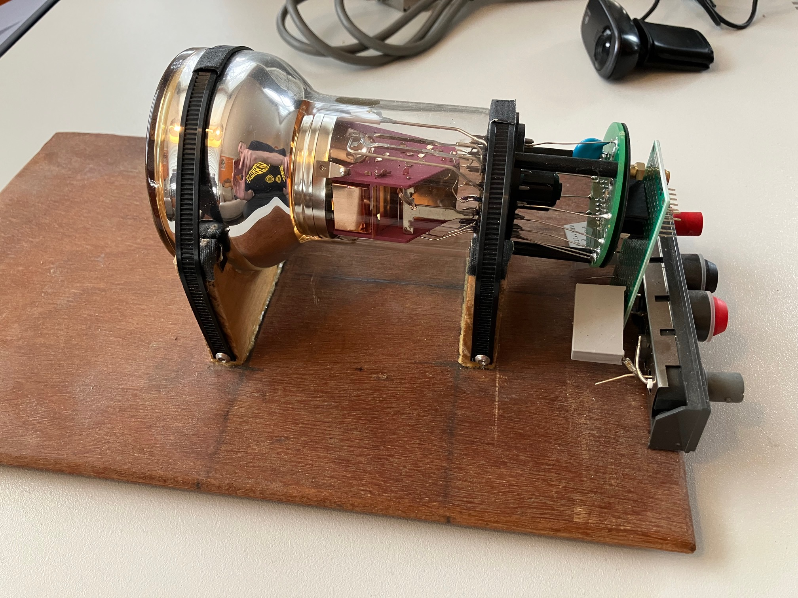
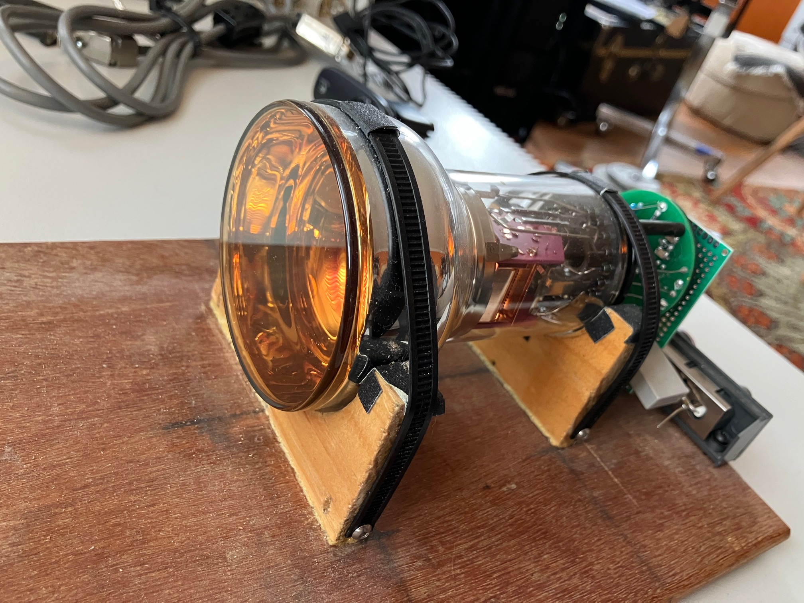

# Photomultiplier Tube (XP3312/SQ) — soft X-ray detector, stage 1

This repo is the **first stage** of a soft X-ray detector: power and sense bring-up for a surplus Photonis **XP3312/SQ** (SN 294056) on a wooden harness with its stock Philips medical I/O filter board (dual-row header + coax + local R/C). The board is a **filter/breakout**, not a full dynode divider — the Type A HV string and anode path are designed here before later detector integration. **No HV applied yet.**



*Bring-up harness: tube cradled on plywood, stock circular filter PCB, divider protoboard, banana HV + BNC anode.*



*Photocathode end of the tube in the harness cradles.*

## Prior — verified pin map (continuity 2026-11-01)

Unpowered DMM checks locked the tube↔header map and corrected the filter cluster. **PASS.** This is the prior gate for HV bring-up — not an energize stage.

| Item | Path |
|---|---|
| **Verified netlist** | [`docs/probable-netlist.md`](docs/probable-netlist.md) |
| Pin reconciliation | [`docs/pin-reconciliation.md`](docs/pin-reconciliation.md) |
| Continuity checklist | [`docs/continuity-checklist.md`](docs/continuity-checklist.md) |
| KiCad project | [`hardware/pmt-interface/`](hardware/pmt-interface/) |
| Schematic (page 1 filter) | [`hardware/pmt-interface/pmt-interface.kicad_sch`](hardware/pmt-interface/pmt-interface.kicad_sch) |
| Schematic (page 2 bringup) | [`hardware/pmt-interface/bringup-supply.kicad_sch`](hardware/pmt-interface/bringup-supply.kicad_sch) |
| Filter PCB (2-layer clone) | [`hardware/pmt-interface/pmt-interface.kicad_pcb`](hardware/pmt-interface/pmt-interface.kicad_pcb) |
| PCB preview | [`docs/pmt-interface-pcb.pdf`](docs/pmt-interface-pcb.pdf) |
| Circular pin map | [`docs/tube-pin-map.md`](docs/tube-pin-map.md) |
| PDF preview | [`docs/pmt-interface-draft.pdf`](docs/pmt-interface-draft.pdf) |
| Photo BOM / traces | [`docs/photo-bom.md`](docs/photo-bom.md), [`docs/photo-trace-map.md`](docs/photo-trace-map.md) |
| Datasheets | [`docs/sources.md`](docs/sources.md), [`docs/datasheets/`](docs/datasheets/) |
| Board photos | [`docs/img/`](docs/img/) |
| Bring-up harness photos | [`docs/img/bringup/`](docs/img/bringup/) |

## HV bring-up (multi-stage)

Gated ladder: design/build divider + anode measure **before** any HV; dark ramp with encoded voltage ceilings; scope anode before Pico. **No HV applied yet.**

| Item | Path |
|---|---|
| **Bring-up index + status** | [`docs/bringup/README.md`](docs/bringup/README.md) |
| Voltage / current ceilings | [`docs/bringup/ceilings.md`](docs/bringup/ceilings.md) |
| **Bring-up BOM** (divider + anode + DNP) | [`docs/bringup/bom-divider.md`](docs/bringup/bom-divider.md) |
| Gate 0 design | [`docs/bringup/gate-0-design.md`](docs/bringup/gate-0-design.md) (**PASS**) |
| Gate 0b sch verify | [`docs/bringup/gate-0-sch-verify.md`](docs/bringup/gate-0-sch-verify.md) (**PASS**) |
| Gate 0c SPICE | [`docs/bringup/gate-0-spice.md`](docs/bringup/gate-0-spice.md) — KiCad (**PASS**) |
| Next | Gate A **on hold** — stuff per [`bom-divider.md`](docs/bringup/bom-divider.md) (sch stays equiv) → B → C → Stages 1–8 |

Ceilings (first pass): Stage 1 **100 V** → Stage 2 **400 V** → Stage 3 **800 V** → Stage 4 **1000 V** dark; abs max **1500 V**.

Regenerate after editing the generator:

```bash
python3 hardware/pmt-interface/gen_fp.py          # tube footprint only
python3 hardware/pmt-interface/gen_bringup_sch.py # page 2 Type A divider + anode
python3 hardware/pmt-interface/gen_sch.py         # page 1 filter + hier link; --validate
python3 hardware/pmt-interface/gen_pcb.py         # photo-matched 2-layer filter PCB
```

Schematic routing: [`.cursor/skills/kicad-schematic-routing/SKILL.md`](.cursor/skills/kicad-schematic-routing/SKILL.md).

## Tube identity

- Photonis XP3312/SQ — Made in France
- Date 29-Sep-04, batch 04229, SN 294056
- PH 36 pC, PHR 8.7%

## Verified board map (summary)

Tube view: **bottom looking up**, `sp` south, pins **1…19 clockwise**.

J1 is a **DIP-14–style wide IC socket** (7.62 mm / 300 mil row spacing, wrap numbering — **not** IDC ribbon Odd/Even):

```text
  1 -------- 14
  2 -------- 13
  ...
  7 --------  8
```

| Electrode | Tube | Board |
|---|---|---|
| D1…D8 | 1,3,4,7,8,9,10,11 | J1 **8,9,6,5,4,12,3,2** |
| K | 16 | C1 `472Z` 2 kV to GND; R1 `1001` 1 kΩ → **J1.7** |
| A | 12 | coax center; R2 `115` ~1.1 MΩ → GND |
| GND | — | **J1.14** + coax shell |
| Filter | — | **D8** and **J1.13** each via tan MLCC to mid → R3 `100` 10 Ω → GND |

J1.1 / 10 / 11: photo-consistent NC (pads, no fan-out); DMM still required (11 least clear).

## License

SPDX-License-Identifier: `CERN-OHL-S-2.0`

Hardware sources and accompanying project materials are under the [CERN Open Hardware Licence Version 2 - Strongly Reciprocal](LICENSE). See also [`NOTICE`](NOTICE).
# photomultipler-tube
